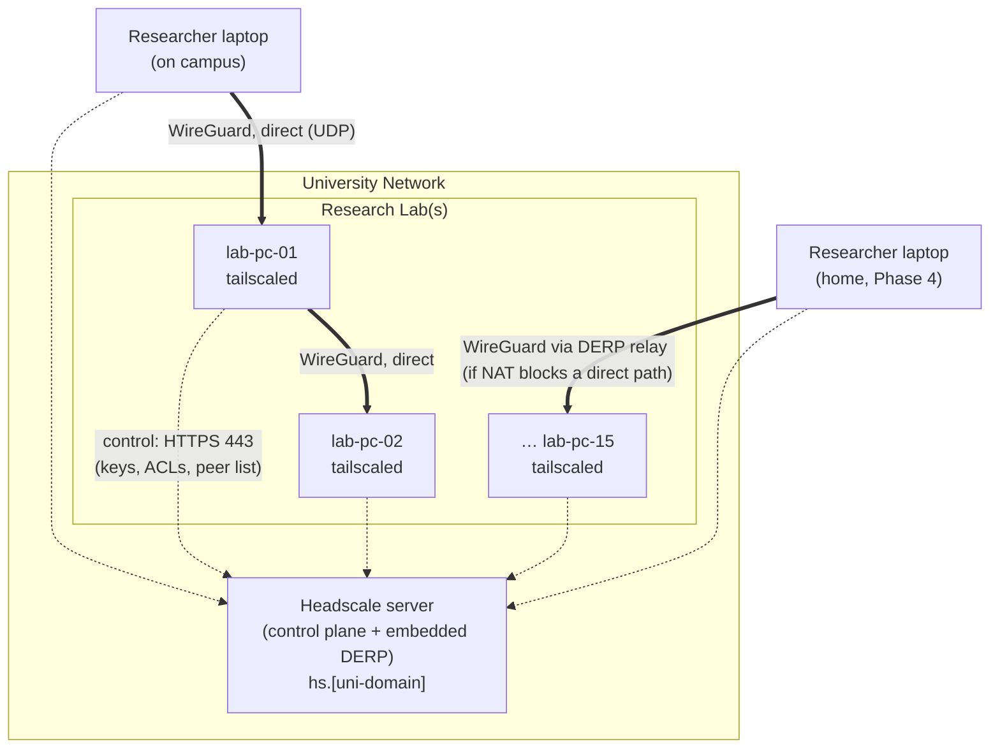

# Proposal: Self-Hosted Mesh VPN for Research Labs Using Headscale (15-Machine Pilot)

> **Status:** Draft v0.1, 2026-10-13. Written in Markdown for now; it will be converted to LaTeX later.
> **Proposers:** _[Names, IDs, department]_  **Supervisor:** _[Name]_  **Lab(s):** _[Lab names / room numbers]_
> **Plan format:** Phased tasks with checkboxes (`- [ ]`). Each phase ends with a "Done when" check.

**Goal:** Give authorised lab members secure, managed access to research-lab PCs from anywhere on campus (and, once approved, off campus). We'll do this with a WireGuard-based mesh VPN run by a **self-hosted Headscale control server on a university machine**, piloted on **15 lab PCs**.

**Architecture:** Each lab PC runs the official open-source Tailscale client. Instead of logging in to Tailscale's cloud service, every client registers with our own Headscale server, which hands out keys, IP addresses, DNS names and access rules. Traffic flows **directly and end-to-end encrypted between machines** (WireGuard). When a direct path can't be made through NAT or the firewall, traffic passes through a DERP relay, still encrypted. Headscale only coordinates the network; it never sees the traffic.

**Tech Stack:** Headscale (latest stable release, pinned at deployment), Tailscale client (Linux/Windows), WireGuard, Ubuntu Server 24.04 LTS, SQLite, Caddy (TLS reverse proxy), systemd, Prometheus + Grafana (monitoring), optional Headplane web UI.

**Spec:** This document. No separate spec exists yet.

---

## 1. Background and Motivation

Our research labs have many PCs, several of them with GPUs, that students and researchers need for experiments. Today, getting to them remotely is hard:

- Students have to be physically in the lab to start or check long training runs.
- Opening ports (SSH/RDP) on the campus firewall for each machine is unsafe, and IT rarely allows it.
- The usual workarounds (personal AnyDesk/TeamViewer accounts, ad-hoc tunnels) can't be managed or audited, and are insecure.

We first considered the hosted **Tailscale** service. We chose **Headscale**, an open-source, self-hosted version of Tailscale's control server, for these reasons:

| Factor | Tailscale (hosted) | Headscale (self-hosted) |
|---|---|---|
| Who controls the coordination server | Tailscale Inc. (outside the university) | **The university** |
| Cost | Free tier limits users; paid plans charge per user | **Free** (open source, BSD-3) |
| User/device limits | Plan-dependent | No license limits |
| Data residency of metadata (device list, IPs, users) | Third-party cloud | **On campus** |
| Client software | Official Tailscale clients | **Same official clients** |
| Maintenance effort | None | We run it (small, a single binary) |
| Features | Full feature set | Core features: mesh, ACLs, MagicDNS, subnet routers, exit nodes, OIDC. Some SaaS features (e.g. Funnel) are missing |

## 2. Objectives

1. **O1:** Deploy a production-grade Headscale server on a university machine, with HTTPS, backups and monitoring.
2. **O2:** Enrol **15 lab PCs** and the pilot users. Each PC should take **≤ 10 minutes** to enrol.
3. **O3:** Enforce **least-privilege access rules** (ACLs): researchers reach only lab PCs, only on approved ports; admins have full access.
4. **O4:** Measure how well the network works: the share of direct vs relayed connections, latency, throughput, server uptime, and what happens when the control server goes down.
5. **O5:** Produce runbooks and a go/no-go recommendation for scaling to every lab.

## 3. Scope

| In scope (pilot) | Out of scope (pilot) |
|---|---|
| 1 Headscale server + 15 lab PCs + pilot users' laptops | All labs / whole department |
| SSH, RDP/VNC and file transfer between members and lab PCs | Replacing the university VPN or network |
| ACLs, MagicDNS, pre-auth key enrolment | Exit nodes for general internet use (disabled) |
| Linux and Windows lab PCs | Mobile devices (optional, personal laptops only) |
| Optional: university SSO (OIDC) login | Making lab services public on the internet |

## 4. How It Works

### 4.1 Architecture



- **Control plane (Headscale):** registers nodes, gives out tailnet IPs (`100.64.0.0/10`, `fd7a:115c:a1e0::/48`), shares public keys, pushes ACLs and DNS settings. It **never carries user traffic**.
- **Data plane (WireGuard):** peer-to-peer and encrypted. NAT traversal uses STUN. When both sides are behind restrictive NATs or firewalls, traffic goes through a **DERP relay** over HTTPS, still end-to-end encrypted.
- **If Headscale goes down:** connections that already exist keep working. New devices can't join and ACL changes don't reach clients until it's back. Phase 3 tests this explicitly.

### 4.2 Enrolment Flow (one lab PC)

1. The admin creates a short-lived pre-auth key that applies the `tag:labpc` tag.
2. On the PC: install the Tailscale client, then run `tailscale up --login-server https://hs.[uni-domain] --authkey <key> --hostname lab-<room>-<nn>`.
3. Headscale registers the node, applies the tag, and gives it an IP and a MagicDNS name (`lab-<room>-<nn>.lab.internal`).
4. The PC shows up in `headscale nodes list`, and ACLs immediately control who can reach it.

## 5. Technical Specifications

### 5.1 Headscale Server: Hardware

The server can be a dedicated mini PC or desktop, or a VM on university infrastructure. Headscale itself is very light. The specs below leave headroom for the embedded DERP relay and the monitoring stack.

| Component | Minimum | Recommended (pilot + room to scale to ~200 nodes) |
|---|---|---|
| CPU | 2 cores x86-64 | 4 cores (e.g. Intel i5 / Ryzen 5 mini PC) |
| RAM | 2 GB | 8 GB |
| Storage | 32 GB SSD | 256 GB NVMe SSD |
| Network | 1 GbE, **static IP** | 1 GbE, static IP, **public IP or port-forward** (§8) |
| Power | — | **UPS** (≥ 650 VA, ≥ 15 min runtime) |
| Physical location | Lab | Server room or locked rack in the lab |

### 5.2 Headscale Server: Software

| Component | Choice | Notes |
|---|---|---|
| OS | Ubuntu Server 24.04 LTS | Unattended security upgrades turned on |
| Headscale | Latest stable `.deb` from the official GitHub releases, **version pinned** | Runs as a systemd service. Check the Headscale ↔ Tailscale client version compatibility notes before each upgrade |
| Database | SQLite (Headscale's recommended backend) | `/var/lib/headscale/db.sqlite` |
| TLS / reverse proxy | Caddy 2 (automatic Let's Encrypt certificates) | Must pass WebSocket and HTTP upgrade traffic through to Headscale |
| DERP relay | Headscale's embedded DERP server (one campus region) + Tailscale's public DERP map as fallback | IT can choose to drop the public fallback (§8, U6) |
| Monitoring | Prometheus (scrapes Headscale's `/metrics`) + Grafana + node_exporter; Uptime Kuma for external HTTPS checks | |
| Admin UI (optional) | Headplane (third-party web UI) | The CLI is enough for the pilot |
| Backups | Nightly `restic` to department storage | See §5.6 |
| Hardening | `ufw` (default deny inbound), SSH key-only login, `fail2ban`, no other services | |

### 5.3 Network Ports

| Where | Port / Protocol | Direction | Purpose |
|---|---|---|---|
| Headscale server | **TCP 443** | Inbound | Control-plane API + DERP over HTTPS |
| Headscale server | **TCP 80** | Inbound | Let's Encrypt HTTP-01 challenge (not needed if a DNS-01 challenge or a university-issued certificate is used) |
| Headscale server | **UDP 3478** | Inbound | STUN for the embedded DERP (NAT discovery) |
| Headscale server | TCP 22 | Inbound, **admin IPs only** | Server administration |
| Headscale server | TCP 50443 (gRPC), 9090 (metrics) | **Localhost only** | Remote CLI and metrics. Never exposed |
| Lab PCs / clients | **UDP 41641** | Outbound (inbound helps) | WireGuard direct connections |
| Lab PCs / clients | UDP 3478, TCP 443 | Outbound | STUN, control plane, DERP |

If the campus firewall blocks outbound UDP, everything still works, but it all runs through DERP over TCP 443, which is slower. The pilot will measure exactly this.

### 5.4 Key Configuration (`/etc/headscale/config.yaml`, excerpt)

```yaml
server_url: https://hs.[uni-domain]          # public HTTPS name of the server
listen_addr: 127.0.0.1:8080                  # behind Caddy
metrics_listen_addr: 127.0.0.1:9090
grpc_listen_addr: 127.0.0.1:50443

prefixes:
  v4: 100.64.0.0/10                          # confirm no overlap with campus CGNAT (§8, U7)
  v6: fd7a:115c:a1e0::/48
  allocation: sequential

derp:
  server:
    enabled: true
    region_id: 999
    region_code: "campus"
    region_name: "Campus DERP"
    stun_listen_addr: "0.0.0.0:3478"
  urls:
    - https://controlplane.tailscale.com/derpmap/default   # fallback relays; remove if IT requires

database:
  type: sqlite
  sqlite:
    path: /var/lib/headscale/db.sqlite

dns:
  magic_dns: true
  base_domain: lab.internal                  # must differ from the server_url domain
  nameservers:
    global: ["[university DNS 1]", "[university DNS 2]"]

policy:
  mode: file
  path: /etc/headscale/policy.hujson
```

Config keys change between Headscale releases, so this file is checked against the `config-example.yaml` of the pinned version at deployment.

### 5.5 Access Control Policy (`policy.hujson`, pilot draft)

```jsonc
{
  "groups": {
    "group:admins":      ["admin1@", "admin2@"],
    "group:researchers": ["alice@", "bob@"]          // filled from the pilot user list
  },
  "tagOwners": {
    "tag:labpc":  ["group:admins"],
    "tag:gpu":    ["group:admins"]
  },
  "acls": [
    // Admins: full access to everything
    { "action": "accept", "src": ["group:admins"], "dst": ["*:*"] },

    // Researchers: SSH, RDP, VNC and Jupyter to lab PCs only
    { "action": "accept", "src": ["group:researchers"],
      "dst": ["tag:labpc:22,3389,5900,8888"] },

    // Lab PCs may talk to each other (distributed training, file sync)
    { "action": "accept", "src": ["tag:labpc"], "dst": ["tag:labpc:*"] }

    // Anything not listed is DENIED by default
    // Lab PCs cannot start connections to researchers' personal laptops
  ]
}
```

User naming (`alice@`) follows the policy format of recent Headscale releases. It will be checked against the pinned version's documentation.

### 5.6 Backup and Recovery

| What | Path | Frequency | Retention |
|---|---|---|---|
| Database | `/var/lib/headscale/db.sqlite` (snapshot with `sqlite3 .backup`) | Nightly | 30 days |
| Noise private key | `/var/lib/headscale/noise_private.key` | On change | Permanent, encrypted |
| DERP private key | `/var/lib/headscale/derp_server_private.key` | On change | Permanent, encrypted |
| Config + policy | `/etc/headscale/` | On change (kept in a private git repo) | Permanent |

**Recovery target:** a rebuilt server is serving again within **2 hours** of a hardware failure (RTO), and at most **24 hours** of changes are lost (RPO). We'll restore once during Phase 3 to prove this works.

### 5.7 Pilot Machine Inventory (to be filled in)

| # | Hostname | OS | Role | Room | GPU | Owner/Responsible |
|---|---|---|---|---|---|---|
| 1 | `lab-[room]-01` | Ubuntu 22.04/24.04 | General | | | |
| … | … | … | … | | | |
| 15 | `lab-[room]-15` | Windows 11 | General | | | |

The aim is a mix of roughly **10 Linux + 5 Windows** machines, including at least **2 GPU workstations** and at least **2 different rooms/subnets**, so the pilot covers real conditions.

**Client notes:**
- **Linux:** install from `pkgs.tailscale.com`. The `tailscaled` systemd service is enabled at boot.
- **Windows:** use the official MSI. Enrol from an admin shell with `tailscale up --unattended --login-server ... --authkey ...`. The `--unattended` flag keeps the node connected when no user is logged in, which lab PCs need.
- Disable auto-update during the pilot and upgrade clients on a schedule, so all versions stay compatible with the pinned Headscale.

## 6. Implementation Plan

### Phase 0: Approvals and Preparation (Weeks 1–2)

- [ ] Submit the proposal to the supervisor, the lab in-charge and IT. Get written approval.
- [ ] Get the network items in §8 from IT: static IP, DNS name, firewall rules, check that the IP range doesn't conflict.
- [ ] Choose the 15 pilot PCs and fill in the §5.7 inventory. Get approval from the owner of each PC.
- [ ] Choose the pilot users (about 10–20) and publish an acceptable-use note (§9).

**Done when:** we have signed approvals, a DNS name that resolves to the server's IP, firewall rules requested or applied, and a completed inventory.

### Phase 1: Server Deployment (Weeks 2–3)

- [ ] Install Ubuntu 24.04 and harden it (ufw, SSH keys, fail2ban, unattended-upgrades).
- [ ] Install the pinned Headscale `.deb`, then write `config.yaml` (§5.4) and `policy.hujson` (§5.5).
- [ ] Install Caddy with a TLS certificate for `hs.[uni-domain]`. Check that `https://hs.[uni-domain]/health` returns OK from both on campus and off campus (off-campus only if approved).
- [ ] Turn on the embedded DERP. From a test client, `tailscale netcheck` should list the "campus" region.
- [ ] Set up Prometheus + Grafana dashboards (node count, online nodes, server CPU/RAM/network) and an Uptime Kuma check.
- [ ] Set up nightly backups (§5.6).

**Done when:** two test laptops can enrol and `tailscale ping` each other, `netcheck` shows the campus DERP, and the dashboard shows both nodes.

### Phase 2: Enrol the 15 Lab PCs (Weeks 3–4)

- [ ] Create users (`headscale users create <name>`) and the admin/researcher groups.
- [ ] Create a **single-use or 24-hour** pre-auth key per batch with tag `tag:labpc` (`tag:gpu` for GPU machines).
- [ ] Install the client on each PC and enrol it with the naming scheme `lab-<room>-<nn>`. Time each enrolment.
- [ ] Reboot every PC and check that it reconnects with no one logged in (especially Windows `--unattended`).
- [ ] Enrol the pilot users' laptops (interactive login, or a per-user key).
- [ ] Write the **enrolment runbook** (Linux + Windows), with screenshots.

**Done when:** `headscale nodes list` shows 15/15 lab PCs online after a reboot, and the average enrolment time is ≤ 10 minutes.

### Phase 3: Functional, Security and Resilience Testing (Weeks 4–6)

- [ ] **Connectivity matrix:** run `tailscale ping` between every pair of nodes and record direct vs DERP for each pair.
- [ ] **Performance:** run `iperf3` and `ping` between (a) two lab PCs in the same room, (b) PCs in different rooms, (c) a laptop on campus Wi-Fi, (d) off campus (if approved). Compare tailnet vs plain LAN.
- [ ] **ACL tests:** a researcher *can* SSH or RDP to `tag:labpc`; a researcher *cannot* reach admin-only ports or other users' laptops; a lab PC *cannot* start a connection to a laptop. Record each pass or fail.
- [ ] **Revocation:** expire or delete a node, then confirm it loses access within 1 minute. Remove a user from a group, then confirm their access changes.
- [ ] **Control-plane outage:** stop Headscale for 30 minutes. Confirm existing sessions keep working and new enrolments fail cleanly. Restart it and confirm full recovery.
- [ ] **Backup restore:** restore the backup to a spare VM and confirm that the nodes reconnect to it.
- [ ] **Security review:** run a port scan on the server from outside, so only 80/443/3478 should be open. Check the TLS configuration. Review logs.

**Done when:** every test in this phase is recorded in a results table, every ACL test behaves as expected, and the restore meets the RTO in §5.6.

### Phase 4: Pilot Operation (Weeks 6–10)

- [ ] Run the pilot with real users for **4 weeks**.
- [ ] Collect metrics weekly: server uptime, nodes online, direct vs relayed share, support tickets, incidents.
- [ ] Off-campus access, *if IT has approved inbound 443/3478*: users connect from home; measure performance.
- [ ] Optional: connect **OIDC with university SSO** (e.g. Microsoft Entra ID / Google Workspace) so users log in with university accounts.
- [ ] Optional: set up a **subnet router** for lab devices that can't run a client (e.g. a NAS or a lab printer).
- [ ] Send a mid-pilot and an end-of-pilot user survey (ease of use, reliability, usefulness, 1–5 scale).

**Done when:** 4 weeks of metrics have been collected and the survey response rate is ≥ 70 %.

### Phase 5: Evaluation and Recommendation (Weeks 10–12)

- [ ] Analyse the metrics against the success criteria (§11).
- [ ] Write the final report with a go/no-go recommendation and a scale-up plan: all labs, number of nodes, staffing, whether to run a second server for high availability.
- [ ] Hand over runbooks to the lab in-charge and IT: install, enrol, revoke, upgrade, backup/restore, incident response.
- [ ] Present the results to the department and IT.

**Done when:** the report and runbooks are delivered and the presentation is done.

**Rollback (at any point):** uninstall the Tailscale client from the lab PCs (`apt remove tailscale` / uninstall the MSI) and shut down the server. Lab PCs keep their normal network setup, because the pilot changes nothing else on them.

## 7. Materials and Estimated Budget

All software is open source and costs nothing. Prices are **rough estimates** (Bangladesh market, 2026) and must be confirmed with quotes. If IT provides a VM, or an existing lab PC can be reused as the server, the hardware cost drops to almost zero.

| Item | Qty | Est. unit cost (BDT) | Est. total (BDT) | Notes |
|---|---|---|---|---|
| Mini PC for the Headscale server (4-core, 8 GB RAM, 256 GB NVMe) | 1 | 35,000–50,000 | 35,000–50,000 | **Or** reuse an existing lab PC, **or** a university VM (preferred) |
| UPS (650–1000 VA) | 1 | 5,000–9,000 | 5,000–9,000 | Not needed if the server is in the server room |
| External SSD / backup storage (1 TB) | 1 | 7,000–10,000 | 7,000–10,000 | Or department NAS space |
| Network cable / switch port | 1 | 500 | 500 | |
| 15 lab PCs | 15 | — | 0 | Existing lab machines |
| Domain name / TLS certificate | — | — | 0 | University subdomain + Let's Encrypt |
| Software (Headscale, Tailscale client, WireGuard, Caddy, Prometheus, Grafana) | — | — | 0 | Open source |
| **Total (university VM)** | | | **≈ 0–10,000** | |
| **Total (dedicated hardware)** | | | **≈ 48,000–70,000** | |

## 8. What We Need from the University

| # | Request | From | Why | Priority |
|---|---|---|---|---|
| U1 | **A server**: a VM (spec in §5.1) **or** permission to use a dedicated machine in the lab or server room | IT / Lab in-charge | Hosting Headscale | **Must** |
| U2 | **A static IP** for the server | IT / Network | Clients need a fixed address to reach | **Must** |
| U3 | **A DNS record**, e.g. `hs.[uni-domain]`, pointing to the server | IT | HTTPS needs a valid hostname | **Must** |
| U4 | **A TLS certificate**: permission for Let's Encrypt (inbound TCP 80, or a DNS-01 challenge via the university DNS), **or** a university-issued certificate | IT | Clients need a trusted HTTPS endpoint | **Must** |
| U5 | **Firewall rules, on campus:** allow lab subnets to reach the server on TCP 443 + UDP 3478. Allow **outbound UDP 41641** (and UDP in general) from lab subnets | IT / Network | Direct WireGuard paths. Otherwise all traffic is relayed and slower | **Must** |
| U6 | **Firewall rules, off campus (Phase 4):** inbound **TCP 443 and UDP 3478** to the server from the internet (public IP or port-forward). Decide whether Tailscale's public DERP relays may be used as a fallback | IT / Security | Remote access from home, which is the main value for researchers | Should |
| U7 | **Check for IP range conflicts:** confirm the campus doesn't use `100.64.0.0/10` (CGNAT) internally | IT / Network | Avoid routing conflicts | **Must** |
| U8 | **Admin access to the 15 pilot PCs** (or a lab technician during enrolment) | Lab in-charge | Installing the client | **Must** |
| U9 | **Policy approval:** a written OK that a self-managed VPN overlay is allowed on lab machines, under an acceptable-use policy (§9) | IT Security / Department head | Compliance | **Must** |
| U10 | **Backup storage** on a department NAS or university storage (~50 GB) | IT | Offsite backups | Should |
| U11 | **SSO integration (OIDC):** register an application in the university identity provider (e.g. Entra ID or Google Workspace) | IT / Identity team | Log in with university accounts; access ends automatically when someone leaves | Nice to have |
| U12 | A named IT **point of contact** + a maintenance window for firewall changes | IT | Coordination | **Must** |

## 9. Security, Privacy and Acceptable Use

- **End-to-end encryption:** every connection is WireGuard (Curve25519, ChaCha20-Poly1305). The Headscale server and DERP relays cannot decrypt traffic.
- **Default deny:** the only connections allowed are the ones the ACL policy (§5.5) explicitly lists.
- **Least privilege:** researchers reach only lab PCs, only on approved ports. Lab PCs can't start connections to personal devices.
- **Short-lived enrolment keys:** pre-auth keys are single-use or expire within 24 hours, and are never shared in chat groups.
- **Revocation:** when a member leaves, their user and nodes are removed the same day (or automatically through SSO, U11).
- **Metadata stored:** device names, tailnet IPs, public keys, last-seen times, usernames. **No traffic content and no browsing data** are stored.
- **Server hardening:** firewall default-deny, key-only SSH, admin access limited to named admins, automatic security updates, gRPC and metrics bound to localhost.
- **Acceptable use:** the tailnet is for research access to lab machines only. Exit nodes are disabled, so it can't be used to route general internet traffic or bypass university network policy.

## 10. Risks and Mitigation

| Risk | Impact | Likelihood | Mitigation |
|---|---|---|---|
| IT doesn't allow inbound access from off campus | High (no remote access from home) | Medium | Run the pilot on campus only (still useful across labs/subnets) and present the results as evidence for a later request |
| Campus firewall blocks UDP, so all traffic is relayed | Medium (slower) | Medium | Embedded campus DERP keeps relays local; measure and share the data with IT for U5 |
| A single server is a single point of failure | Medium | Low | Existing connections survive outages; UPS; tested backup/restore; standby server for scale-up |
| A Headscale/Tailscale version mismatch breaks clients | Medium | Low | Pin versions, test upgrades on 2 nodes first, read release notes |
| A leaked pre-auth key | High | Low | Single-use or 24-hour expiry, tags limit what an enrolled node can reach, audit `nodes list` weekly |
| A compromised lab PC reaches other machines | High | Low | ACLs limit lateral movement; lab PCs can only reach other lab PCs; host firewalls stay on |
| Too much admin work for students | Medium | Medium | Runbooks; optional Headplane UI; handover to the lab in-charge/IT at scale-up |
| Conflict with the campus IP range (`100.64.0.0/10`) | Medium | Low | Check before deployment (U7); Headscale can use a narrower prefix |

## 11. Success Criteria (Evaluated in Phase 5)

| Metric | Target |
|---|---|
| Lab PCs enrolled and online after a reboot | 15 / 15 |
| Average enrolment time per PC | ≤ 10 min |
| Control-server uptime during the pilot | ≥ 99 % |
| Peer pairs on campus with a **direct** (non-relayed) connection | ≥ 80 % (depends on U5) |
| Added latency, tailnet vs LAN (same campus, direct) | ≤ 5 ms |
| Throughput, tailnet vs LAN (direct path) | ≥ 70 % of LAN throughput |
| ACL tests passed | 100 % |
| Time to revoke access | ≤ 1 min |
| Backup restore meets RTO | ≤ 2 h |
| User satisfaction (survey, 1–5) | ≥ 4.0 average |
| Security incidents | 0 |

## 12. Deliverables

1. A running Headscale server with HTTPS, embedded DERP, monitoring and backups.
2. 15 enrolled lab PCs plus the pilot users.
3. A version-controlled ACL policy and configuration.
4. Runbooks: server install, client enrolment (Linux/Windows), revocation, upgrade, backup/restore, incident response.
5. A test results report: connectivity matrix, performance, ACL, resilience.
6. The final report (LaTeX) with a go/no-go and scale-up recommendation, plus a presentation.

## 13. Timeline (12 weeks)

| Week | 1 | 2 | 3 | 4 | 5 | 6 | 7 | 8 | 9 | 10 | 11 | 12 |
|---|---|---|---|---|---|---|---|---|---|---|---|---|
| P0 Approvals & prep | ■ | ■ | | | | | | | | | | |
| P1 Server deployment | | ■ | ■ | | | | | | | | | |
| P2 Enrol 15 PCs | | | ■ | ■ | | | | | | | | |
| P3 Testing | | | | ■ | ■ | ■ | | | | | | |
| P4 Pilot operation | | | | | | ■ | ■ | ■ | ■ | ■ | | |
| P5 Evaluation & report | | | | | | | | | | ■ | ■ | ■ |

## 14. Team and Roles

| Member | Role |
|---|---|
| _[Name]_ | Project lead, Headscale server, ACL policy |
| _[Name]_ | Client enrolment (Linux/Windows), runbooks |
| _[Name]_ | Monitoring, testing and performance measurement |
| _[Lab in-charge]_ | Machine access, user approval |
| _[IT contact]_ | Network/firewall/DNS, security review |
| _[Supervisor]_ | Supervision, approvals |

## 15. References (to be completed and formatted in LaTeX)

- Headscale project documentation and `config-example.yaml`: github.com/juanfont/headscale, headscale.net
- Tailscale documentation: "How Tailscale works," "DERP servers," "What firewall ports should I open," "ACL policy syntax": tailscale.com/kb
- J. A. Donenfeld, "WireGuard: Next Generation Kernel Network Tunnel," *NDSS*, 2017.
- _[Add: university IT acceptable-use policy; check every citation before submitting.]_
